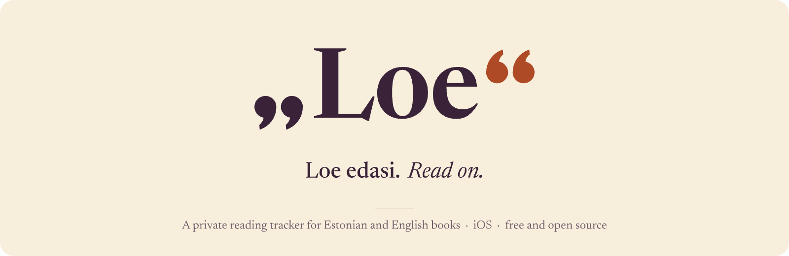
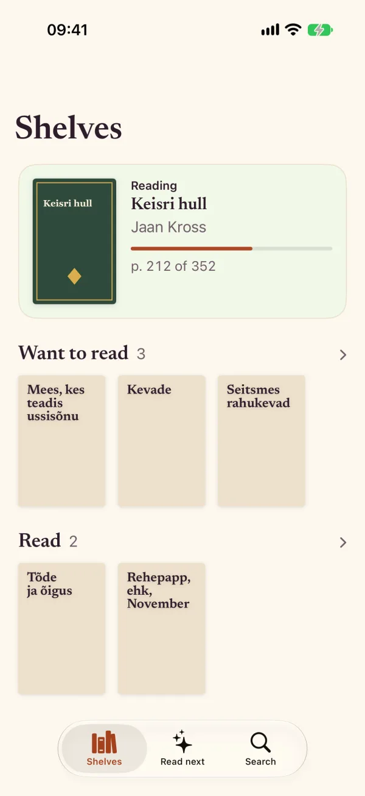
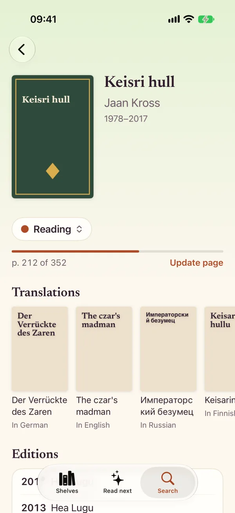
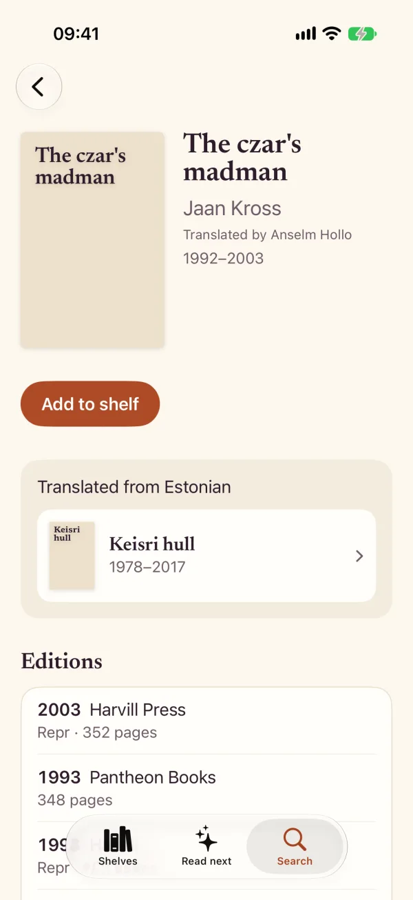
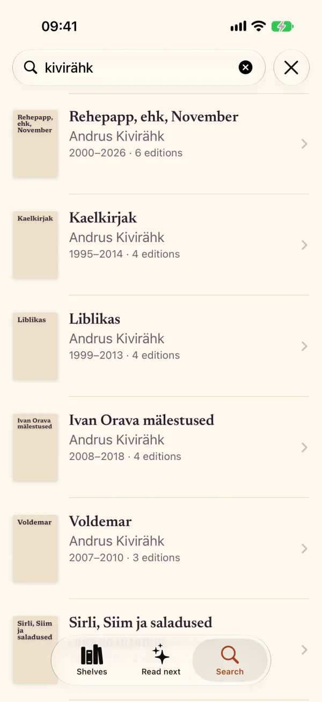

  <picture>
    <source media="(prefers-color-scheme: dark)" srcset=".github/readme/header-dark.png">
    
  </picture>

  
  
  
  
  

  
  
  
  

## Features

- **Every book published in Estonia**, searchable offline: the National Library's bibliography on your phone, found by title, author or ISBN, with or without õ, ä, ö and ü
- **Scan a barcode** on the back of a book to find it
- **A page for every book** with its editions, the original of a translation and the translations of an original, and links to ESTER, Rahva Raamat and Apollo
- **Five shelves**: Reading, Want to read, Read, Set aside and Didn't finish, with ratings and the page you're on
- **Your own covers**: photograph a book, and its page takes a wash of the cover's colour
- **Read next**: suggestions from your own ratings and the kinds of book you like, each with its reason: the next book in a series you're reading, more by authors you rated highly, books like your favourites, and books from your tastes. Worked out on your phone.
- **Private**: no account, no ads, no tracking and no server. Your shelves stay on your phone and in your own iCloud.
- **Estonian and English**, light and dark

## More

- [Documentation](docs/README.md): standards, the catalogue, the library and releasing
- [AGENTS.md](AGENTS.md): how to build, test and ship changes
- Catalogue data: Eesti rahvusbibliograafia, published by Eesti Rahvusraamatukogu (the National Library of Estonia) as open data. See [docs/catalogue.md](docs/catalogue.md).

## Licence

Loe's code is [MPL-2.0](LICENSE). The name and brand artwork are not part of
that grant, see [TRADEMARKS.md](TRADEMARKS.md). Newsreader is under the SIL
Open Font License, in [`Loe/Resources/Licenses`](Loe/Resources/Licenses).
